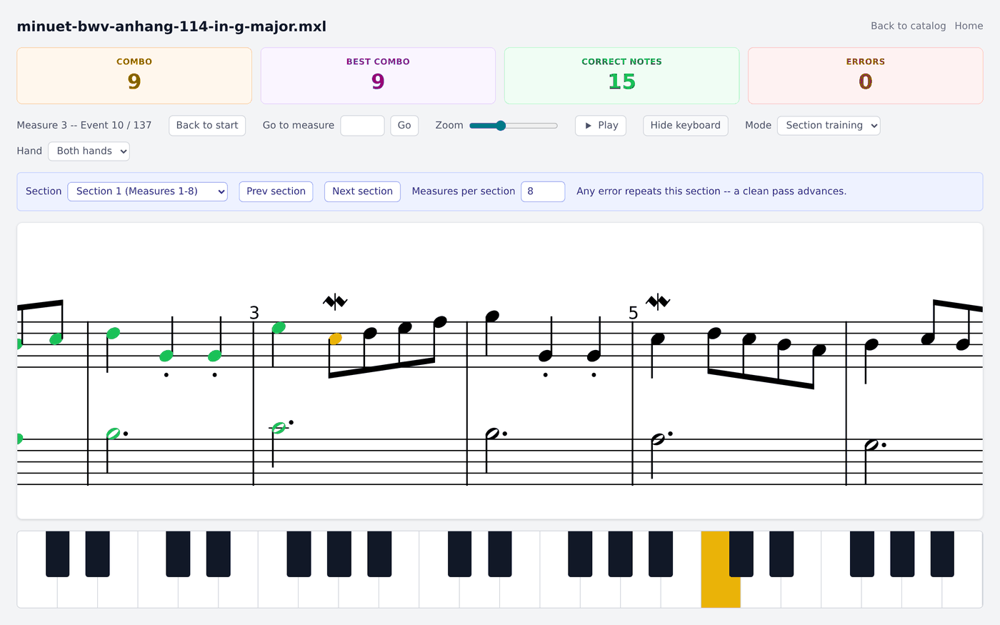
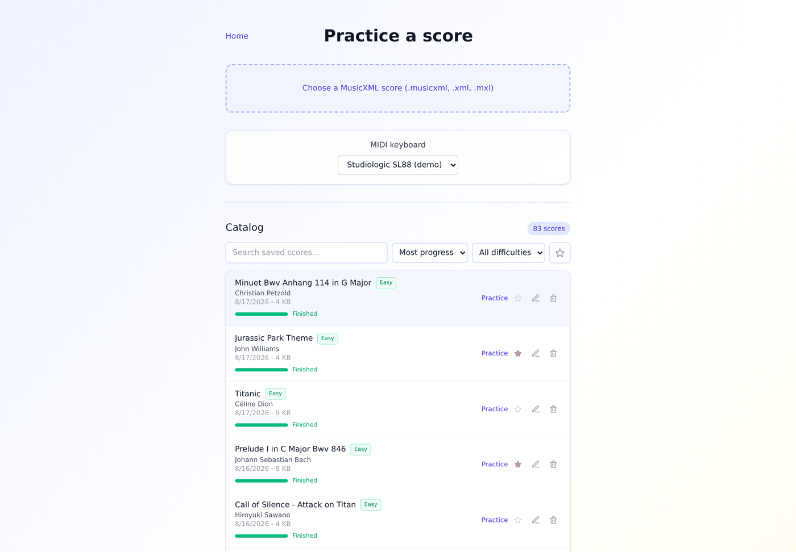
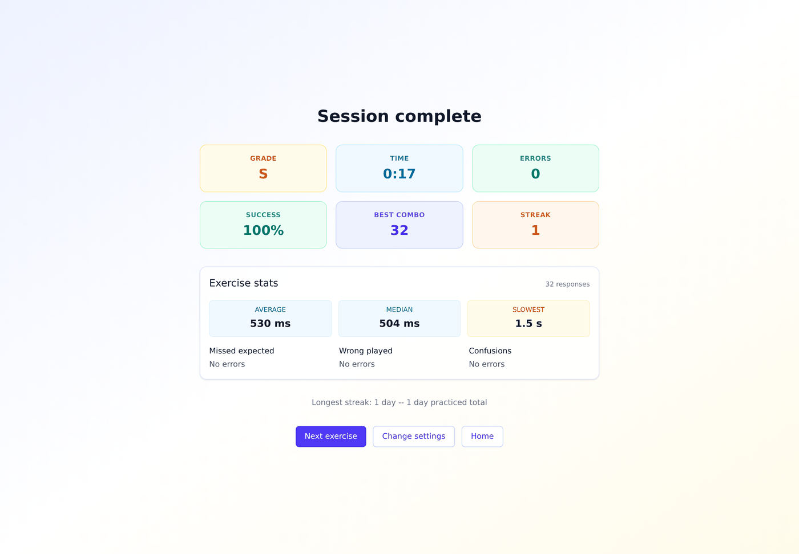

# Piano Trainer

A "Wait Mode" piano practice web app, Simply-Piano-style: load a MusicXML or `.mxl` score, connect a USB/MIDI keyboard, and the score only advances when you play the correct note(s)/chord. No tempo pressure, no composition features -- practice only.



Green is what you played, yellow is what it is waiting for, on the staff and on the on-screen keyboard at the same time. A wrong note reddens that key alone, not the notes you were supposed to play.

**More screenshots and a feature tour: [the wiki](https://github.com/Evanok/piano_trainer/wiki).**

## Stack

React + TypeScript + Vite + Tailwind CSS, plus a minimal `node:http` backend (no framework, no database) that stores the score catalog. Score rendering via [OpenSheetMusicDisplay](https://github.com/opensheetmusicdisplay/opensheetmusicdisplay), keyboard input via the Web MIDI API (Chrome/Edge only -- Firefox and Safari/iOS don't support it).

## Getting started

```bash
npm install
npm run dev
```

Open the printed local URL in Chrome or Edge, connect your MIDI keyboard, then choose Exercise, Practice a score, or Stats from the home screen.

## Navigation and mobile use

The home screen intentionally stays small: Exercise opens the generated-exercise setup page, Practice a score opens upload plus catalog, and Stats shows local exercise history. Practice itself is shared by both playable flows. On phone-sized screens the practice view is designed for landscape use and forces horizontal scroll mode; regular scores keep the virtual keyboard visible as a compact aid, while generated exercises hide it so it does not give away the answer.

## Score catalog

Every score you upload from Practice a score is saved server-side, so you never have to re-pick the same file twice: that page lists the catalog (10 most recently uploaded per page, with a search box), and picking an entry loads it straight into practice.

Scores are listed under their real title and composer, read from the MusicXML itself (`.mxl` files are unzipped to get at it) rather than under their file name. A score whose metadata is empty falls back to a readable form of the file name, and the search box matches title, composer and file name.



Each row shows how far the piece has been played, as a bar and a percentage, turning green when a session has played it through to the end. A piece never practised shows nothing. The figure is the furthest point reached across every session, taken from the shared practice history, so it is the same on every device. The list can be ordered by latest upload (the default), title, last played, most progress or most played, and the order applies to the whole catalog rather than to the page on screen.

Uploads land in `data/` next to the repo (gitignored):

```
data/
  catalog.json          index: id, title, filename, size, upload date
  scores/<uuid>.mxl     the files themselves
```

Set `PIANO_TRAINER_DATA_DIR` to store them elsewhere (recommended on a real deployment, so a redeploy of the code never touches the scores).

## Generated training



The Exercise page generates a short training exercise without uploading a score. Pick the hand setup, exercise type (notes, triads, or mixed), octave range, accidental mode, difficulty and length; the app builds a MusicXML file in memory and opens it through the same Practice pipeline as a normal score. The generator favours small melodic motion, phrase endings on stable scale tones, key signatures, and simple left-hand accompaniment instead of pure random notes. Single-hand exercises can drill notes, triads, or alternating measures of both; two-hand exercises keep the right hand as melody and apply the notes/triads/mixed choice to the left-hand accompaniment. Generated exercises are not saved to the catalog.

## Deployment

Piano Trainer runs on `127.0.0.1:5173` (PM2), behind an nginx reverse proxy that
serves it over HTTPS on its own subdomain (certbot). The nginx site config lives on
the server, not in this repository. The server listens on loopback by default
(`HOST`); set `HOST=0.0.0.0` only for a deployment without a proxy.

Set `PIANO_TRAINER_PASSWORD` on the production server. Without it the whole API
is open to anyone who can reach the app: the practice history can be read,
scores can be uploaded or deleted, and stats can be overwritten. The password
is asked once per device and travels over HTTPS.

### Showing the app to someone else

Set `PIANO_TRAINER_GUEST_PASSWORD` (a different value from
`PIANO_TRAINER_PASSWORD`) to enable a read-only share link. Whoever opens it can
browse the catalog, play any score, run exercises and look at the practice
history, but cannot upload, rename, star or delete a score, and nothing they
play is recorded: the API refuses every write for a guest token, so this holds
for `curl` too, not just for the hidden buttons.

The link is `https://<public-host>/?guest=<token>`. The app offers it on the Home screen ("Share a guest
link"). It carries the credential, so treat it as a password: anyone it is
forwarded to gets the same access, and revoking it means changing
`PIANO_TRAINER_GUEST_PASSWORD` and restarting.

Both passwords live in `piano-trainer.env` on the server (gitignored, mode 600),
in `~/apps/piano_trainer/shared/`, and are loaded when the process starts.

Deployment runs from the development machine with a small shared deploy kit
(kept outside this repository): it checks that the commit is pushed and that
tests, lint and build pass, builds a new release directory on the server,
switches to it, checks that the app answers and rolls back automatically if it
does not:

```bash
./deploy.sh            # deploy origin/master
./deploy.sh status
./deploy.sh rollback
```

Settings: `deploy/deploy.conf`. The previous on-server script is kept as
`deploy/legacy_deploy.sh`.

Production and development both listen on `127.0.0.1:5173`; nginx is the public
entry point, so port 5173 must not be open in the firewall.

In development the same API handler is mounted on the Vite dev server (see
`vite.config.ts`), so `npm run dev` stays a single process and dev/production
cannot drift apart.

## Scripts

- `npm run dev` -- dev server (front-end + catalog API)
- `npm run build` -- typecheck + production build
- `npm start` -- production server on port 5173 (serves `dist/` + the catalog API)
- `./deploy.sh [status|rollback]` -- deploy from the development machine (see Deployment)
- `npm test` -- run the test suite
- `npm run lint` -- oxlint

See `CLAUDE.md` for the internal architecture (score parsing, the wait engine, MIDI handling, note coloring).
